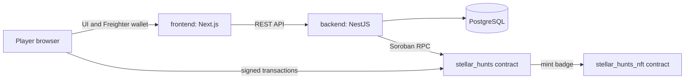

# StellarHunts

StellarHunts is a puzzle game built around Stellar and Soroban. Players solve blockchain and cryptography challenges, progress through difficulty levels, and can claim on-chain NFT badges. The repository is a monorepo containing a Next.js web app, a NestJS API, and Rust Soroban contracts.

## Architecture



The frontend serves the game interface and wallet integration. The backend provides API features and persists application data in PostgreSQL. The game contract manages questions and player progression; the NFT contract issues level badges. Local API development can use the backend's mock Stellar mode without deployed contracts.

## Quickstart

### Requirements

- Node.js 18 or later and npm
- PostgreSQL 13 or later
- Rust and Cargo (only needed to build or test the contracts)
- GNU Make (optional; commands below can also be run from each package)

### Clone and install

```bash
git clone https://github.com/UnityChainxx/StellarHunts.git
cd StellarHunts
npm install
```

The root npm workspace installs frontend and backend dependencies. Create a PostgreSQL database and configure the backend:

```bash
Copy-Item backend/.env.example backend/.env
```

The minimum local configuration is:

```bash
STELLAR_MODE=mock
NODE_ENV=development
PORT=3001
```

Edit `backend/.env` with your local PostgreSQL host, username, password, and database name. For a local UI/API run without deployed contracts, set `STELLAR_MODE=mock`, `NODE_ENV=development`, and `PORT=3001`. Keep `DATABASE_SYNC=true` for a disposable development database only; use migrations and disable synchronization for persistent or production data. See [backend configuration](backend/README.md#getting-started) for the full environment reference.

The schema default for `STELLAR_MODE` is **live**, so local development has to opt in to `mock` explicitly. A deployment that omits the variable without Soroban credentials fails at startup, naming the missing keys, rather than booting and then handing out NFT badges that were never minted on-chain.

### Run

Open two terminals from the repository root:

```bash
npm run dev:backend
```

```bash
npm run dev:frontend
```

The API listens on [http://localhost:3001](http://localhost:3001), and the web app is at [http://localhost:3000](http://localhost:3000). In non-production development, API documentation is available at [http://localhost:3001/docs](http://localhost:3001/docs). Install Freighter in your browser to exercise wallet features.

### Contracts

Install the `wasm32-unknown-unknown` Rust target for WebAssembly builds. Then, from the root:

```bash
npm run test:onchain
npm run build:onchain
```

Contract test and deployment details are in [`onchain/`](onchain/).

## Repository layout

| Directory | Purpose |
| --- | --- |
| `frontend/` | Next.js client, game UI, and Stellar wallet integration |
| `backend/` | NestJS API, authentication, application data, and PostgreSQL integration |
| `onchain/contracts/stellar_hunts/` | Puzzle, progression, and game state contract |
| `onchain/contracts/stellar_hunts_nft/` | Level badge NFT contract |
| `onchain/contracts/stellar_hunts_types/` | Shared Soroban types |
| `docs/` | Project documentation, including the [puzzle author guide](docs/puzzle-author-guide.md) |

## Useful commands

```bash
npm run lint                 # lint backend and frontend
npm run test                 # backend, frontend, and contract tests
npm run build                # production builds for backend and frontend
npm run test:backend:e2e     # backend end-to-end tests
npm run --workspace backend db:migrate  # apply database migrations
npm run --workspace backend db:seed     # insert the core demo dataset
```

Database schema, migration, and seed conventions are documented in
[docs/database-schema.md](docs/database-schema.md).

## Contributing and license

See [CONTRIBUTING.md](CONTRIBUTING.md) for the contribution workflow. StellarHunts is licensed under the MIT License; see [LICENSE](LICENSE).
