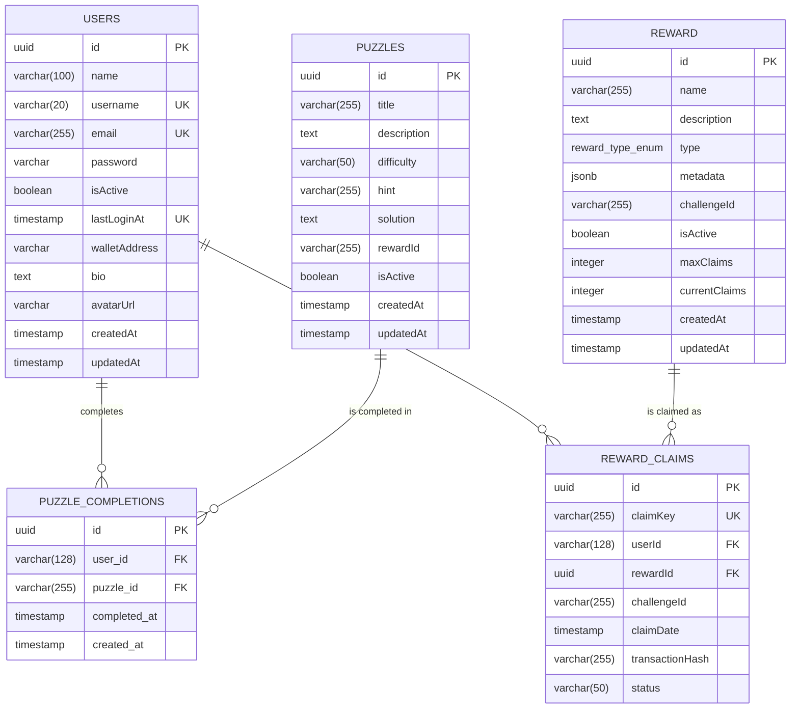

# Database schema and migrations

StellarHunts stores durable game state in PostgreSQL through TypeORM. The
core domain is defined by the baseline migration
`backend/src/database/migrations/1690000000000-create-core-tables.ts` and the
matching entity classes under `backend/src/`.

## Entity-relationship diagram



### Relationship notes

- `reward_claims.rewardId` is an enforced foreign key to `reward.id`
  (`ON DELETE CASCADE`).
- `puzzle_completions` and `reward_claims` store the acting user identifier
  as an opaque `varchar(128)`, matching the current entities. Those columns
  intentionally do not carry a database foreign key because progress can be
  recorded for wallet-authenticated identities before a `users` row exists.
  The relationships above are therefore logical for the actor columns.
- `puzzle_completions` has a unique index on `(user_id, puzzle_id)`, so a
  player can complete a puzzle once.
- `reward_claims` has a unique index on `(userId, rewardId)`, which is the
  final guard against duplicate claims when two requests race.

## Tables

| Table | Purpose | Key constraints |
|-------|---------|-----------------|
| `users` | Player accounts, credentials, and linked wallet address | Unique `username`, `email`, `lastLoginAt` |
| `puzzles` | Off-chain puzzle content and answer material | Index on `(isActive, difficulty)` for discovery |
| `puzzle_completions` | Per-player puzzle completion history | Unique `(user_id, puzzle_id)` |
| `reward` | Reward catalogue keyed by the challenge it belongs to | Index on `(challengeId, isActive)` |
| `reward_claims` | Reward claim ledger | Unique `(userId, rewardId)`, FK to `reward` |

Enum type: `reward_type_enum` with values `nft`, `token`, `badge`, `points`.

## Running migrations

Migrations are **versioned by the timestamp prefix in the filename** and run
in ascending order. The file name and the exported class name must both end
with the same timestamp (`<timestamp>-<description>.ts` /
`<Description><timestamp>`).

```bash
cd backend

# Apply every pending migration
npm run db:migrate

# Inspect applied / pending migrations
npm run db:migrations

# Roll back the most recent migration
npm run db:migrate:revert
```

The CLI uses `backend/src/database/data-source.ts`, which reads the same
`DATABASE_*` variables as the application. Never enable
`DATABASE_SYNC=true` against a database whose schema is migration-managed;
`DATABASE_SYNC` is for throwaway local databases only.

### Adding a migration

1. Create `backend/src/database/migrations/<epoch-ms>-<description>.ts`
   (or a feature-local `migrations/` directory on the same convention).
2. Implement `up()` and a symmetric `down()`; both use the `QueryRunner` API.
3. Use the timestamp of the change, not a placeholder such as `xxxx-`, so
   ordering is deterministic.
4. Run `npm run db:migrate` followed by `npm run db:migrate:revert` on an
   empty database to prove both directions.
5. Update this document and the ER diagram if tables or relationships change.

## Seed data

The core seed is additive and idempotent. It inserts a demo player, three
puzzles, two rewards, two completions, and one reward claim using stable IDs,
so repeat runs do not duplicate rows.

```bash
cd backend
npm run db:seed        # after npm run db:migrate
# or both in one step
npm run db:setup
```

| Variable | Default | Purpose |
|----------|---------|---------|
| `SEED_DEMO_PASSWORD` | `DemoPassw0rd!` | Password for the `demo_player` account; override for any shared environment |
| `SEED_ALLOW_PRODUCTION` | unset | The script refuses to run with `NODE_ENV=production` unless this is `true` |

Demo credentials after seeding: username `demo_player`, password from
`SEED_DEMO_PASSWORD` (or the default above). Change or remove the account
before exposing an environment publicly.

## Related documentation

- [Architecture](architecture.md#database) — where the database sits in the
  system and how modules register entities.
- [API conventions](api-conventions.md) — route prefixes used by the
  endpoints that read and write these tables.
